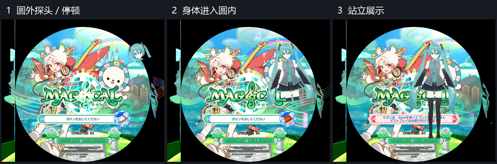

# DesktopMate for maimai

把 Desktop-Mate 那种「动漫角色待在屏幕上」的展示，搬到舞萌（SDEZ / Sinmai）机台上：
**系统闲置或等待刷卡时，角色先在游戏圆形区域外探头，停顿后身体进入圆内；登录后淡出，游玩/结算立即隐藏。**

- 目标版本：SDEZ 1.70（Unity 2018.4.7f1 + MelonLoader 0.6.4，64 位）
- 框架：MelonLoader + Harmony，独立 Mod，**不依赖、不修改 AquaMai**
- 参考实现：`C:\Users\Koileo\Downloads\Desktop-Mate\Desktop Mate\`

实际游戏截图（依次为圆外探头、身体进入、站立）：



截图使用本机初音转换数据；角色模型不随源码或安装包分发。

## 目录

```
├─ README.md
├─ DesktopMateOnMaimai.csproj      # net472，引用游戏 DLL
├─ build.bat                       # 构建 + 安装到 Mods
├─ assets/DesktopMate.toml         # 默认配置（带注释）
├─ src/
│  ├─ ModMain.cs
│  ├─ Config/ModConfig.cs, TinyToml.cs
│  ├─ Core/CabinetWatcher.cs       # 机台状态监听（闲置/未登录）
│  ├─ Core/OverlayCanvas.cs        # 画布/层级/布局/双屏
│  ├─ Core/CharacterStage.cs       # 3D(RT+相机) / 2D(序列帧) 两条渲染通路
│  ├─ Core/CharacterDriver.cs      # 动作原语抽象 + Animator/序列帧实现
│  ├─ Core/IdleBrain.cs            # 待机大脑（状态机/抖动/表情三轨）
│  ├─ Core/CharacterPresenter.cs   # 淡入淡出与滞回
│  └─ Core/CharacterLoader.cs      # AssetBundle / 序列帧加载
└─ docs/
   ├─ 01-Desktop-Mate结构分析.md    # 可复用的结构、动画与待机逻辑
   ├─ 02-舞萌适配说明.md            # 分辨率/层级/触发/配置/运行环境
   └─ 03-模块划分与实现要点.md      # 模块图、实现要点、里程碑、测试清单
```

## 本机使用：Desktop Mate 初音

本机 `miku.cb` 已转换为 `assets/local/miku-local/character.dmc` 和 PNG 贴图，构建时复制到游戏角色目录。它使用原模型、骨骼、蒙皮和表情，不是占位图；原始 Desktop Mate 文件保持不变。

```bat
build.bat "D:\BaiduNetdiskDownload\SDEZ170_nobga_v2\SDEZ170\Package"
```

安装后的配置保留以下设置，修改后重启游戏：

```toml
[Display]
Renderer = "3D"
CircleEntrance = true
CircleCenterX = 0.5
CircleCenterY = -1
CircleRadius = 0.5
HeadFraction = 0.20

[Character]
Id = "miku-local"
YawDegrees = 180
```

上面是相关字段示例，请合并到原有栏目，勿重复添加同名栏目。`build.bat` 保留已有配置。圆形模式忽略 `Anchor/OffsetX/OffsetY`，位置由圆心、半径与进场路径决定；`CircleEntrance=false` 可恢复角落模式。

当前移植保留几何、骨骼和 23 个表情形变，使用游戏自带材质近似显示，以及程序控制的呼吸、眨眼、视线和挥手。原版 lilToon 光照、动作控制器、头发/裙摆物理尚未移植。

## 无本地模型时：2D 测试

1. 构建（需要 .NET SDK 6/8）：

   ```bat
   build.bat D:\maimaiHDD\SDEZ170\Package
   ```

   `build.bat` 会自动识别安装在 `%LOCALAPPDATA%\Microsoft\dotnet-sdk-8` 的用户 SDK，也支持 PATH 里的 SDK。

2. 通用默认配置使用 `Renderer="2D"`、`Id="placeholder"`。首次构建安装 6 帧简易测试图，只用于检查布局；换正式素材时替换以下文件：

   ```
   <Package>\Mods\DesktopMate\Characters\placeholder\sprites\
       idle_0.png  idle_1.png  idle_2.png ...   # 待机
       peek_0.png  ...                          # 可选
       wave_0.png  ...                          # 可选
       blink_0.png ...                          # 可选（眨眼）
   ```

   PNG 建议透明底、统一画布尺寸、高度 1000~1200 px（会按 `HeightPixels` 缩放）。

3. 启动游戏。安装后的配置在 `<Package>\Mods\DesktopMate\DesktopMate.toml`；修改后重启生效。再次构建会保留已有配置和角色。

4. 等到广告循环 15 秒后，角色出现；投币刷卡后淡出。

## 其他 3D 资源

原始 `.cb` 或解码后的 Unity 6 AssetBundle 不能交给 Unity 2018.4 直接加载。本机初音通过 `tools/read_character_bundle.py` → `tools/export_local_character.py` → `tools/validate_portable_character.py`，将数据转换为独立格式 `DMCHAR01` 后，由 `PortableCharacter` 重建。转换工具需要 Python、UnityPy、NumPy、cryptography 及 `.tools/asset-converter/keys.bin`；格式参考 [DesktopMateAssetDecryptor](https://github.com/Xyzstk/DesktopMateAssetDecryptor)。本地转换产物不随源码分发，其他角色尚未经过画面验证。

离线转换示例（项目根目录运行，Python 3.12）：先执行 `python -m pip install -r tools/requirements.txt --target .tools/python`，再从上述格式参考仓库取得 `DesktopMateAssetDecryptor/keys.bin`，放到 `.tools/asset-converter/keys.bin`。

```powershell
python tools/read_character_bundle.py "C:\path\to\miku.cb" .tools/miku.unity3d --decode-only
python tools/export_local_character.py .tools/miku.unity3d "C:\path\to\miku.cb" assets/local/miku-local
python tools/validate_portable_character.py assets/local/miku-local/character.dmc
```

也支持自行导出的 Unity 2018.4 AssetBundle：

1. 装 Unity **2018.4.7f1** + [UniVRM 0.63.x]（VRM 0.x）；
2. 导入 VRM → 配 Animator（`Idle` / `Peek` / `Stretch` / `Wave` / `Blink` 这些 State 或 Trigger，名字与配置里的 `IdleVariants` 对齐）；
3. 材质用 MToon（built-in RP）；
4. 打 AssetBundle（目标平台 Windows x64），命名 `character.ab`；
5. 放到 `<Package>\Mods\DesktopMate\Characters\<id>\character.ab`，配置 `Renderer = "3D"`。

## 配置

### 本机 Desktop Mate 角色批量转换

本机已有的 `.cb` 角色包可以转换为本 Mod 读取的 `character.dmc`，不需要让 Unity 2018 直接加载 Unity 6 的资源包：

```powershell
python tools/convert_all_characters.py "<Desktop Mate目录>\DesktopMate_Data\StreamingAssets\AssetBundle" --install "<Package目录>\Mods\DesktopMate\Characters"
```

Python 环境需要 NumPy、cryptography，以及 `.tools/python` 下的 UnityPy 和 `.tools/asset-converter/keys.bin`。导出保存在 `assets/local/<角色包名小写>-local/`；每个角色只有在网格、骨骼权重、索引、表情数据、贴图和文件长度检查通过后才安装。完整结果见 `assets/local/conversion-report.json`，角色 ID 与切换说明见 `assets/local/CHARACTERS.md`。后续 `build.bat` 会复制所有已转换的本机角色。

在游戏配置的 `[Display]` 下设置 `Renderer = "3D"`，在 `[Character]` 下设置角色 `Id`，例如 `sanrio_cinnamoroll-local`，重启游戏生效。

转换保留默认启用的模型网格、骨骼、表情形变和主贴图；原版着色器使用简化材质替代，不包含原版动画控制器、布料或头发物理。当前动作驱动主要匹配初音的骨骼命名，其他角色的动作、表情及外观需要在游戏中确认。转换结果仅保存在本机。

配置文件：`<Package>\Mods\DesktopMate\DesktopMate.toml`（首次运行自动生成）。
全部字段释义见 `docs/02-舞萌适配说明.md` §5，默认模板见 `assets/DesktopMate.toml`。

最常改的几个：

| 想做的事 | 改哪 |
|---|---|
| 换角色 | `Character.Id` |
| 调整圆周位置 | `Display.CircleCenterX` / `CircleCenterY` / `CircleRadius` |
| 调整探头节奏 | `Animation.PeekInSeconds` / `PeekHoldSeconds` / `EnterSeconds` |
| 使用角落位置 | `CircleEntrance=false` 后设置 `Anchor` / `OffsetX` / `OffsetY` |
| 改大小 | `Display.Scale`、`Character.HeightPixels` |
| 改透明度 | `Character.Opacity` |
| 关掉某个触发 | `Trigger.ShowInAttract` / `ShowInEntryWaiting` / `ShowInCommercial` |
| 待机动作节奏 | `Animation.IdleMinSeconds` / `IdleMaxSeconds` / `TimeJitter` |
| 人物挡住 AquaMai 菜单 | `Display.SortingOrder` 调到 1000 以下 |

## 状态说明

| 机台状态 | 进程 | 表现 |
|---|---|---|
| 闲置/招揽 | `Process.AdvertiseProcess` | 显示 |
| 广告视频段 | `Process.AdvertiseCommercial.AdvertiseCommercialProcess` | 由 `ShowInCommercial` 控制 |
| 自动演示游玩 | `Process.AdvDemoProcess` | 显示 |
| 未登录/待刷卡 | `Process.EntryProcess`（`ConfirmEntry` / `ConfirmFelica` / `WaitPartner` …） | 白名单内显示；未知/关闭的界面隐藏 |
| 已登录/读盘中 | `DisplayPleaseWait` / `DoneEntry` | 淡出 |
| 游玩/结算 | `Process.GameProcess` / `ResultProcess` | `HideDuringGame=true` 时立即隐藏并停止动画，优先于 `ForceShow` |

## 构建与判定验证（2026-11-01）

- 已使用 .NET SDK **8.0.427** 和本机 SDEZ170 Package 的 DLL 构建 Release：**0 警告、0 错误**。
- 已运行 `build.bat`，安装 DLL 和本地转换的 `miku-local` 到本机 Package 的 `Mods`；安装配置选择 3D 初音。
- 修复了 Harmony 类型名冲突、Unity 引用缺失、F9 关闭后无法再开启、广告开关无效，以及游玩/结算未立即隐藏的问题。
- **20 项无界面判定检查通过**，覆盖显示延迟、转场进程干扰、探头时间线、资源失败隐藏、登录后隐藏、广告开关和游玩优先级。运行方式：

  ```powershell
  & "$env:LOCALAPPDATA\Microsoft\dotnet-sdk-8\dotnet.exe" run --project tests\BehaviorChecks\BehaviorChecks.csproj -c Release
  ```

这些检查使用生产判定与配置源码，替换了画布、动画与日志，不验证 Unity 渲染或触摸。`Debug.CaptureOnShow=true` 会在首次展示保存 `head-peek.png`、`body-enter.png`、`display-check.png` 及离屏人物图 `character-texture.png` 到 `Mods/DesktopMate/`。双屏、AquaMai 菜单和刷卡全流程仍需实机验收。

已在本机 1080×1600 游戏窗口验证上图三个阶段，修复正脸朝向和衣服深度闪点。本机安装配置等待 18 秒，使标题动画先完成；通用模板仍为 15 秒。`tools/package_release.ps1` 生成只含 DLL、配置、2D 测试图和安装说明的发布 ZIP；[安装说明](docs/04-安装与验证.md) 包含验证范围。

## 注意

- 引用其他游戏目录时，使用 `build.bat "<Package路径>"`，或给 `dotnet build` 传 `-p:MaimaiDir=...`。
- Mod 只做显示，不碰判定、不碰输入、不改 `QualitySettings` / `RenderSettings`。
- 角色素材版权自负；Desktop-Mate 的角色包请勿直接分发。
