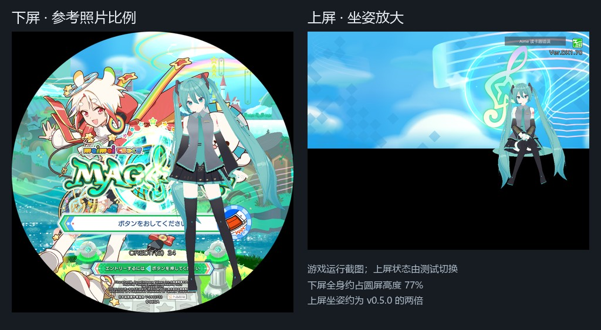
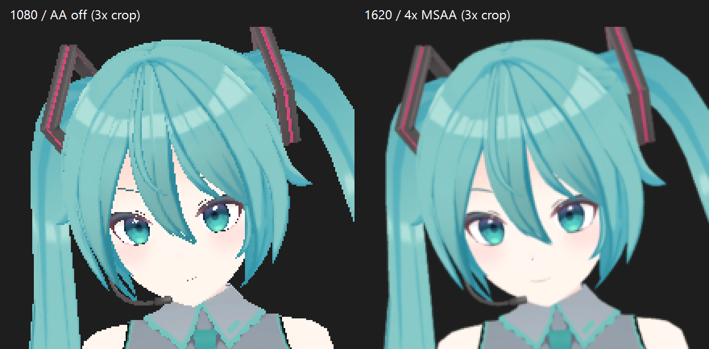

# DesktopMate for maimai

让 Desktop Mate 角色在舞萌闲置时陪伴玩家：**靠右站立、进入刷卡流程即淡出，登录后可选上屏坐姿，游玩与结算时淡出隐藏。** 角色显示时，触摸游戏圆屏可得到短动作或微笑回应。

适用于 Windows x64、SDEZ 1.70 / Sinmai、Unity 2018.4.7f1、MelonLoader 0.6.4。独立运行，可与 AquaMai 共存。

## 安装

下载发布 ZIP，退出游戏后将其中 `Mods` 合并至游戏的 `Package/Mods`。v0.5.3 起发布包默认附带 Miku 的 3D 模型、贴图和动作，首次安装即可使用。

从源码构建并安装，需要 .NET SDK 8 和游戏目录中的 Unity / MelonLoader DLL：

```bat
build.bat "D:\maimaiHDD\SDEZ170\Package"
```

脚本自动查找项目内 `.tools/dotnet`、用户目录或 PATH 中的 SDK，保留已有配置和角色。源码安装需先准备 `assets/local/miku-local` 转换产物；也会安装其他 `assets/local/<id>` 角色。

```text
Package/Mods/
├─ DesktopMateOnMaimai.dll
└─ DesktopMate/
   ├─ DesktopMate.toml
   └─ Characters/<id>/
      ├─ character.dmc + PNG + motion.dmm   # 本地转换的 3D 角色
      ├─ character.ab                      # 或 Unity 2018.4 AssetBundle
      └─ sprites/idle_0.png ...            # 或 2D 透明序列帧
```

每个角色只需选择一种资源方式。原始 Desktop Mate `.cb` 不可直接加载，转换步骤见[角色资源与开发](docs/开发与角色转换.md)。

## 显示与互动

| 场景 | 角色表现 |
| --- | --- |
| 标题 / 招揽 | 首次等待 15 秒，在下屏右侧淡入；连续可展示页面切换不重复计时 |
| 刷卡 / 登录流程 | 一进入流程就原地淡出，等待刷卡时也保持隐藏 |
| 广告视频 | 默认隐藏，可通过 `ShowInCommercial` 开启 |
| 登录后选曲等页面 | F8 切换上屏坐姿；无键盘可开启自动落座 |
| 游玩 / 结算 | 默认立即开始淡出，完全隐藏后停止动作 |
| 角色显示时触摸圆屏 | 站姿优先点头，缺少该动作时依次尝试挥手、换重心、思考；坐姿只微笑 |

下屏保持大比例靠右站立，脚放到圆边下方，腿由圆形边界自然遮挡，避免在圆屏内露出悬空的脚。站姿补偿支撑脚高度和整体漂移；上屏坐姿放大并靠右显示。默认固定位置淡入，没有消息框或屏幕按钮。F9 开关角色显示。



触摸接入游戏 `InputManager`，只读取按下事件，不消费或修改输入。默认冷却 8 秒；忙碌、进场、隐藏及游玩/结算时忽略触摸，不排队补播。`PlayerSlot=2P` 只响应 2P，其余选项跟随单角色的 1P 区域。接口不可用时自动退回普通陪伴。

v0.5.4 默认在休息时保持固定站姿，停止站立循环、呼吸起伏、重心漂移和噪声微动；思考、叉腰等主动动作仍保留，结束后平滑回到固定站姿。保留眨眼、微笑、眉毛与嘴部变化，视线固定朝前，旧配置也不会再开启随机眼神。只从角色支持的动作中抽取，动作之间保留安静停顿。

角色默认使用 1620×1620 离屏渲染、4× MSAA 与三线性贴图过滤，缩小显示以减轻大屏锯齿。只影响角色自身，不修改游戏全局画质；显卡不支持多重采样时自动关闭 MSAA。性能较弱的机台可将 RenderTextureWidth/Height 改回 1080，并将 RenderTextureAntiAliasing 改为 2 或 1。



## 配置

修改 `Package/Mods/DesktopMate/DesktopMate.toml` 后重启游戏。完整注释见[默认配置](assets/DesktopMate.toml)，布局与兼容说明见[舞萌适配说明](docs/02-舞萌适配说明.md)。以下字段合并到已有同名栏目：

```toml
[Display]
Renderer = "3D"
RenderTextureWidth = 1620
RenderTextureHeight = 1620
RenderTextureAntiAliasing = 4
PlayerSlot = "Auto"
CircleEntrance = true
AnimatedEntrance = false
CircleHeightRadius = 1.65
CircleResidentX = 0.46
CircleResidentY = -1.12
AllowUpperSeat = true
UpperSeatOnLogin = false
UpperSeatX = 0.78
UpperSeatY = 0.48
UpperSeatHeight = 0.52

[Character]
Id = "miku-local"
YawDegrees = 180

[Interaction]
TouchEnabled = true
TouchCooldownSeconds = 8

[Animation]
StandingIdleMotion = 0
IdleVariants = ["Idle", "Think", "HandsOnHips", "Shift", "LookAround", "Nod", "Wave"]
IdleWeights = [7, 2, 1, 1, 1, 1, 1]
```

默认配置使用 `Renderer="3D"`、`Id="miku-local"`、`YawDegrees=180`，与发布包自带的 Miku 资源一致。上屏陪伴需要竖屏上方区域与角色真实坐姿。`UpperSeatOnLogin=true` 可在每轮登录后自动落座。`ReducedMotion=true` 保留固定站姿、坐姿、透明度过渡和微笑，减少额外手势。

从 v0.5.3 升级并保留旧配置时，将 `Animation.StandingIdleMotion` 改为 `0`，以关闭之前的 25% 站立摆动。`EnableLookAt` 与 `GazeRadius` 仅保留旧配置兼容，不再改变待机视线。

刷卡流程的隐藏规则也适用于旧配置中的 `ShowInEntryWaiting=true` 及调试 `ForceShow`。淡出默认 0.35 秒、淡入 0.6 秒；转场中途反向时沿用当前透明度，不重置角色姿势。

升级时请同步上方尺寸参数，尤其 `CircleResidentY=-1.12`；安装脚本保留已有配置。固定站位使用 CircleResidentX/Y，Y 支持 -1.8~0，旧版进场的 CircleRestAngle/Radius 不控制固定站位。`CircleEntrance=false` 可使用自定义角落位置，这时需要自行确认遮挡。

## 验证与限制

```powershell
dotnet build DesktopMateOnMaimai.csproj -c Release -p:MaimaiDir="D:\maimaiHDD\SDEZ170\Package"
dotnet run --project tests/BehaviorChecks -c Release
dotnet run --project tests/MotionChecks -c Release
```

无界面检查覆盖状态切换、换位、触摸冷却与降级、双玩家事件隔离、旧版进场安全带和动作连续性，不代替真实触摸板与画面验收。实机检查步骤见[安装与验证](docs/04-安装与验证.md)，旧版本记录保存在 [docs/archive](docs/archive)。

本地转换保留模型、骨骼、蒙皮、表情和主贴图，可使用已导出的 Humanoid 动作；原版着色器、动画控制器、布料与头发物理尚未完整移植。其他游戏版本、双玩家机台及真实刷卡/触摸板流程需现场确认。

发布包只附带默认 Miku 的运行时资源，其他角色需自行准备。第三方格式与依赖见 [THIRD_PARTY.md](THIRD_PARTY.md)。
