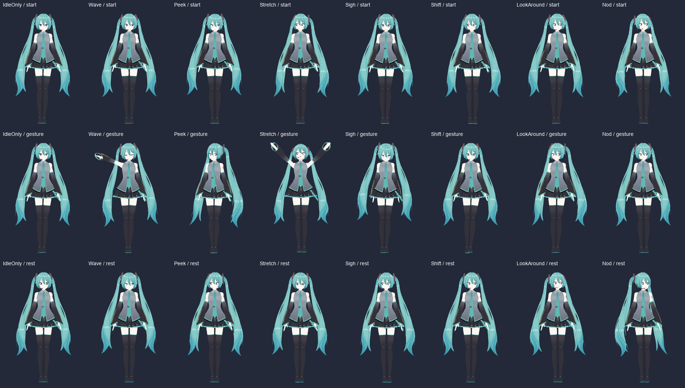

> 历史设计与验收归档；当前行为和配置以 README 及默认配置为准。

# v0.3 本机游戏动作验收

日期：2026-11-01（北京时间）。环境：本机 SDEZ 1.70 / Sinmai、Unity 2018.4.7f1、MelonLoader 0.6.4、AquaMai 1.9.7；游戏画面 1080×1600，角色为 `miku-local`，人物 RenderTexture 为 756×1080，动作速度与幅度倍率均为 1.0。

## 本次修正

- `IdleBrain` 的防重复逻辑不再将连续 Idle 替换为 Shift；只配置一种动作时会持续遵守该选择。
- 进场落定使用零位移、零速度起步的下沉包络，消除进入落定段时直接下跳 7px 的不连续。
- 游戏首轮验收发现 Stretch 在顶点和收臂过程中会切掉手部。降低其顶点抬臂角度，并增加双臂前伸量；保持相机取景与角色大小。

## 自动检查

Release 构建：0 警告、0 错误。原有 20 项状态检查和新增 27 项动作检查均通过。

```powershell
& "$env:LOCALAPPDATA\Microsoft\dotnet-sdk-8\dotnet.exe" build -c Release
& "$env:LOCALAPPDATA\Microsoft\dotnet-sdk-8\dotnet.exe" run --project tests\BehaviorChecks\BehaviorChecks.csproj -c Release
& "$env:LOCALAPPDATA\Microsoft\dotnet-sdk-8\dotnet.exe" run --project tests\MotionChecks\MotionChecks.csproj -c Release
```

动作检查直接使用生产待机调度、进场时间线和动作运行时。单一 Idle 配置模拟十分钟无手势插入，视线仍持续更新。落定关闭、0.1s、0.35s、2s 四种时长均无边界跳变，结束后严格归零。默认落定在 60fps 采样下最大下沉约 7.16px、回弹约 2.69px，最大单帧位移约 2.85px。

## 游戏内验证

实际启动游戏并加载 v0.3.0 DLL。临时诊断模块在正常招揽界面出现后，先运行 12 秒单一 Idle 配置，再依次播放七段动作。动作阶段直接触发生产 MotionRig，由生产 RigDriver、PoseBinder、相机和游戏 UI 完成姿态应用与显示；诊断模块只控制调度和采样，不替换渲染或骨骼绑定。

第二轮最终采集 2,929 帧运行数据、393 张人物 RenderTexture 图，以及探头、进入、落定和各手势的游戏截图。

| 项目 | 结果 |
|---|---|
| 单一 Idle | 12 秒游戏运行期间未插入手势；呼吸、视线与眨眼仍有变化 |
| Wave / Peek / Stretch / Sigh / Shift / LookAround / Nod | 七段均观察到播放状态，并完整结束 |
| 姿态数值 | 2,929 帧无 NaN 或 Infinity |
| 人物取景 | 393 张图均未触及贴图边缘（alpha ≥ 24 的可见像素）；Stretch 手部裁切已消除 |
| 进场 | 正常等待 18 秒后出现，探头、进入、落定截图已检查 |

人物姿态抽样（依次为动作开始、动作中、动作结束；结束后基础视线仍会继续变化）：



实际游戏画面（探头、身体进入、落定、伸展）：


原始逐帧数据、PNG 序列、诊断日志和旧 DLL 备份保存在本机 `.tools/runtime-motion/`；动画预览保存在 `dist/motion-check-v0.3.gif`。这些本机文件不包含在发布 ZIP 中。临时诊断期间仅在内存中切换 Idle 配置与 ForceShow，结束后恢复；原安装配置文件的 SHA256 与验收前一致。

验收后已退出诊断进程、移除 `DesktopMateMotionProbe.dll`，再用原安装配置正常启动游戏。新日志确认加载 v0.3.0、初音 3D 就绪并正常进入招揽/演示展示；未发现异常日志。安装 DLL 与本次 Release 构建的 SHA256 一致。已生成 `dist/DesktopMateOnMaimai-v0.3.0.zip` 和配套 SHA256，ZIP 仅包含 Mod、默认配置、2D 测试图与安装说明。

## 验收范围

本次覆盖初音、当前窗口尺寸及默认动作倍率。其他角色、其他取景比例、更高动作幅度、刷卡全流程、触摸板、双屏、AquaMai 菜单层级和长时性能仍需分别验证。
